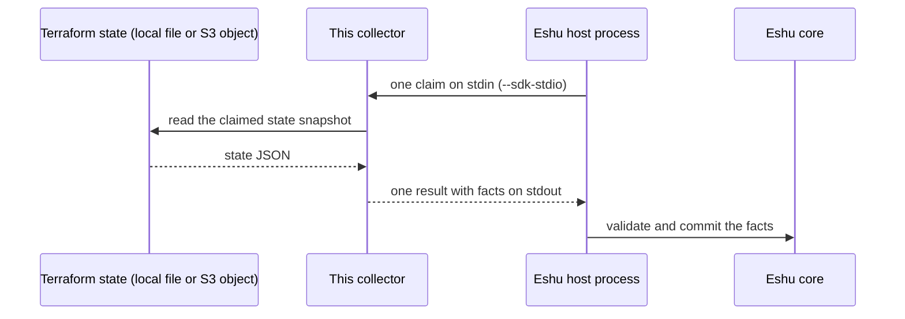

# eshu-collector-terraform-state

**Status: pre-release.** Eshu core still owns this data in production.
This repo has no authority to publish facts on its own yet.

This collector reads Terraform state files and hands Eshu evidence
about what Terraform last applied, so you can answer which resources,
modules, and outputs a state snapshot records.

Terraform state is the file Terraform writes after a run to remember
what it created.
A *fact* is one small, typed piece of evidence.
A *claim* is one bounded request to collect one scope.
The *host* is the Eshu process that starts this collector, sends it a
claim, and stores the result.
This collector only collects and returns evidence. It does not store anything itself and never runs Terraform.

## What it collects

The table below is generated from `spec.emittedFacts` in
[manifest.yaml](manifest.yaml).
That file declares 9 fact kinds, all at schema version `1.0.0` with
`observed` confidence (read directly from the state artifact).

| Fact kind | Plain meaning |
|---|---|
| `terraform_state_snapshot` | One state snapshot as a whole, with its digest |
| `terraform_state_resource` | One resource recorded in the state |
| `terraform_state_output` | One Terraform output recorded in the state |
| `terraform_state_module` | One module recorded in the state |
| `terraform_state_provider_binding` | Which provider a module or resource is bound to |
| `terraform_state_tag_observation` | Tags seen on one state resource |
| `terraform_state_warning` | Part of the state could not be read or trusted fully |
| `incident_routing.applied_pagerduty_resource` | A PagerDuty resource Terraform applied |
| `incident_routing.applied_alert_route` | An alert route Terraform applied |

This collector never declares or emits `terraform_state_candidate`;
that kind stays owned by git-based collection in Eshu core.
It also does not emit `incident_routing.coverage_warning`, which the
PagerDuty collector owns.
State files can hold secrets.
Sensitive attribute values are redacted or withheld before emission;
only allow-listed drift attribute leaves are emitted, and the
hard-sensitive `aws_iam_policy` document is never emitted.

## How it fits in



In text: Terraform state (local file or S3 object) -> this collector -> Eshu host process -> Eshu core.

## When to use it

Use it when Eshu needs evidence of what Terraform applied: the
resources, outputs, modules, provider bindings, and tags recorded in
one or more state snapshots, plus PagerDuty routing resources found
in applied state.

## When not to use it

- Do not use it to run, plan, or apply Terraform. It only reads state.
- Do not use it as a state browser for humans.
  It returns facts to the Eshu host; it has no user interface.
- Do not expect it to show live cloud resources.
  State can be stale; this collector reports what the state records,
  not what the cloud has now.
- Do not feed it state you cannot let it read.
  It redacts before emission, but the process still reads the file.

## How Eshu runs it

The host runs one claim per process invocation.
It starts `./collector --sdk-stdio`, writes one
`collector-sdk/v1alpha1` request to stdin, and reads one result from
stdout.
The host owns admission, identity, storage, and recovery.
This binary never commits facts itself and holds no endpoint, queue,
or datastore handle to submit anything to.

```bash
go run ./cmd/collector --sdk-stdio < request.json > result.json
go run ./cmd/collector --input ./testdata/complete.json
```

The binary is also its own installer:

```bash
collector seed --dest DIR --image-ref ghcr.io/eshu-hq/eshu-collector-terraform-state@sha256:<digest>
```

`seed` writes the collector binary and [manifest.yaml](manifest.yaml)
into `DIR`.
Without `--image-ref`, `COLLECTOR_IMAGE_REF` supplies the reference.
The manifest pins the Linux amd64 image for version `0.1.0` by
digest:
`ghcr.io/eshu-hq/eshu-collector-terraform-state@sha256:36b51cee5abe3f7734cbcaeb79a005165a3a9694bd3a62a562799668583dd8e9`.
The image entrypoint is `/usr/local/bin/collector --sdk-stdio`
(see [Dockerfile](Dockerfile)).

## Configuration

Copy [config.example.yaml](config.example.yaml).
With `source.input` set, the collector reads one local state file.
Without it, `discovery` plus `target_scopes` takes the live S3 path:
bucket filters resolve to exact state objects, and each candidate
must pass the target-scope allow-list before it is read.

| Name | Required | Default | Meaning |
|---|---|---|---|
| `host.sourceSystem` | Yes in the example | `terraform_state` | Source system recorded on facts |
| `host.scope.id` / `host.scope.kind` | Yes in the example | `component:terraform-state-primary` / `component` | Host scope for the claim |
| `process.command` / `process.args` | Yes in the example | `./collector` / `--sdk-stdio` | How the host starts this binary |
| `config.source.mode` | No | `local-file` in the example | Local-file source mode |
| `config.source.input` | For local mode | Flag default `testdata/complete.json` | State file to read |
| `config.source.sourceURI` | No | `https://example.invalid/source/terraform-state` | Credential-free source address recorded on facts |
| `config.freshness.previousDigest` | No | Empty | Prior snapshot digest for unchanged detection |
| `config.limits.maxRecordsPerClaim` | No | `5000` | Maximum facts in one claim |
| `config.limits.maxPayloadBytes` | No | `65536` | Maximum bytes in one fact payload |
| `config.limits.claimTimeoutSeconds` | No | `300` | Maximum wall-clock seconds for one claim |
| `config.discovery.backend_filters[]` | For live S3 | None | Bucket, region, backend kind, and target scope to search |
| `config.target_scopes[]` | For live S3 | None | Allow-list: provider, regions, backends, deployment mode |
| `AWS_S3_ENDPOINT` (env) | No | Unset uses AWS regional endpoints | Trusted S3-compatible base URL (MinIO or offline mirror) |
| `AWS_STS_ENDPOINT` (env) | No | Unset uses the AWS default | Endpoint for the workload-identity token exchange |

Local flags mirror the file form: `--input`, `--source-uri`, `--previous-digest`, `--max-records`, `--max-payload-bytes`, and `--claim-timeout-seconds`. Zero selects the default; negative values fail.
Endpoint overrides must be credential-free `http` or `https` base
URLs with no query or fragment.
Instance-metadata addresses are refused, plain `http` is accepted
only on loopback (and, for S3 only, single-label in-cluster names
such as `http://minio:9000`), and error text never echoes the value.
There is no credential key anywhere in config.

## Credentials and least privilege

Live S3 reads use ambient workload credentials only: IRSA web
identity first (the Kubernetes service account identity exchanged
for AWS credentials), then the standard process environment
credential variables.
No credential key exists in config, and source credentials never
enter fact payloads, source URIs, logs, or statuses.
Source URIs that embed `user:secret@host` or `password=`, `secret=`,
or `token=` query values are refused.
This repo does not name a specific AWS policy, so grant the workload
identity only read access to the state buckets and objects the
allow-list names, and stop there.

## Claim budget and operator signals

One claim is bounded by the limits above (defaults: 5,000 records,
65,536 payload bytes per fact, 300 seconds) and a retry queue bound
of 8, past which the collector fails terminal instead of queuing
forever.
Each run writes one `collector health:` JSON line to stderr with
liveness, last success time and digest, failure count and reason,
retry depth, and the effective limits.
Health text carries no credentials or payloads.
The manifest declares the metric prefix `eshu_dp_tfstate_`; the
stderr health line is the operator signal proven by the code here.
Missing state objects degrade a live claim to partial with a
`state-missing` warning; throttling releases the claim as retryable;
a bucket outside the allow-list fails the claim closed.

## Eshu dependencies

| Dependency | Version or contract | Source |
|---|---|---|
| `github.com/eshu-hq/eshu-sdk/collector` | `v0.1.0-rc.3` | `go.mod` |
| `github.com/eshu-hq/eshu-sdk/factschema` | `v0.1.0-rc.8` | `go.mod` |
| Host protocol | `collector-sdk/v1alpha1`, `process` adapter | [manifest.yaml](manifest.yaml) |
| Eshu core compatibility | `>=0.0.5 <0.2.0` | [manifest.yaml](manifest.yaml) |
| Producer identity | `dev.eshu.collector.terraform-state`, version `0.1.0` | [manifest.yaml](manifest.yaml) |

There are no `replace` directives; a clean clone resolves both SDK modules through the Go module proxy. Producer grants are issued by Eshu core, not this repo. [grant.example.json](grant.example.json) is the request shape: 9 entries, one per emitted kind at schema `1.0.0`, scope `terraform_state`.

## What this never does

- It never writes to the Eshu graph, Postgres, or any queue.
  It imports no core storage handle; the host validates and commits.
- It never commits facts or decides final truth.
  Its manifest declares reducer phase `source_evidence_only:no_graph_truth`.
- It never runs Terraform and never writes or locks state.
- It never emits raw sensitive state values; redaction happens
  before emission and hard-sensitive documents are withheld.

## Build, test, and release

```bash
make ci
```

`make ci` runs `make lint`, `make test`, and `make race` (see
[Makefile](Makefile)): vet, lint and format checks, module drift,
the 500-line file cap, the full test suite, and the race suite with
a coverage floor (`COVERAGE_FLOOR`, default `80.7`, may only rise).
`scripts/run-conformance.sh` runs the same conformance gate CI runs.
Releases: `version` in [manifest.yaml](manifest.yaml) and the git
tag must match (`v0.1.0` for `0.1.0`).
Pushing a `v*` tag on the protected `main` head runs the release
workflow, which builds, signs, and publishes the image with SBOM and
provenance attestations.
Any other tag fails before anything builds or pushes.
Artifacts stay digest-pinned; re-pin after a push with
`scripts/pin-digest.sh`.

## Docs and related repos

- [PORT_PLAN.md](PORT_PLAN.md) — port plan and grant/rollback pointers
- [NOT_PORTED.md](NOT_PORTED.md) — what stays in Eshu core
- [eshu](https://github.com/eshu-hq/eshu) — Eshu core
- [eshu-sdk](https://github.com/eshu-hq/eshu-sdk) — collector and fact-schema contracts
- [eshu-deploy](https://github.com/eshu-hq/eshu-deploy) — deployment charts and activations

## Contributing, security, and license

See [CONTRIBUTING.md](CONTRIBUTING.md) before opening a change; it
names the redaction and source-URI tests that must stay green.
There is no `SECURITY.md` and no `LICENSE` file in this repo.
Source files carry `SPDX-License-Identifier: MIT` headers.
