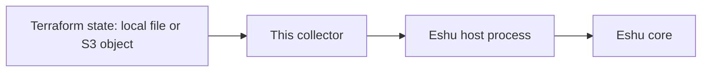

# eshu-collector-terraform-state

**Status: pre-release.** Eshu core still owns this data in
production. This repo has no authority to publish facts on its own
yet.

In a nutshell: this collector reads Terraform state files and
hands Eshu evidence about what Terraform last applied. Eshu can
then answer which resources, modules, and outputs a state
snapshot records. The collector only collects and returns
evidence; it doesn't store anything itself and never runs
Terraform.

In text: Terraform state (local file or S3 object) -> this
collector -> Eshu host process -> Eshu core.

## When to use it

Use it when Eshu needs evidence of what Terraform applied: the
resources, outputs, modules, provider bindings, and tags recorded
in one or more state snapshots, plus PagerDuty routing resources
found in applied state.

## When not to use it

- Don't use it to run, plan, or apply Terraform. It only reads state.
- Don't use it as a state browser for humans.
  It returns facts to the Eshu host; it has no user interface.
- Don't expect it to show live cloud resources.
  State can be stale; this collector reports what the state
  records, not what the cloud has now.
- Don't feed it state you can't let it read.
  It redacts before emission, but the process still reads the file.

## How Eshu runs it

The host runs one claim per process invocation.
It starts `./collector --sdk-stdio`, writes one
`collector-sdk/v1alpha1` request to stdin, and reads one result
from stdout. The host owns admission and storage; this binary
never commits facts itself.

## Documentation

Start at the [docs index](docs/README.md). Shortcuts people use most:

| Page | What you'll find there |
|---|---|
| [Getting started](docs/getting-started/README.md) | Run it once, see facts come back |
| [Configuration](docs/reference/configuration.md) | Every config field, credentials, and the claim budget |
| [Facts](docs/reference/facts.md) | The fact kinds it emits, mirroring the manifest |
| [Diagrams](docs/diagrams/README.md) | Every diagram, with captions and text versions |

Older notes: [PORT_PLAN.md](PORT_PLAN.md) covers the port plan and
grant/rollback pointers, and [NOT_PORTED.md](NOT_PORTED.md) lists
what stays in Eshu core.

## Related repos

- [eshu](https://github.com/eshu-hq/eshu), Eshu core
- [eshu-sdk](https://github.com/eshu-hq/eshu-sdk), collector and fact-schema contracts
- [eshu-deploy](https://github.com/eshu-hq/eshu-deploy), deployment charts and activations

## Development

Run `make ci` to check a change the way CI does.

## Contributing, security, and license

See [CONTRIBUTING.md](CONTRIBUTING.md) before opening a change; it
names the redaction and source-URI tests that must stay green.
There's no `SECURITY.md` and no `LICENSE` file in this repo.
Source files carry `SPDX-License-Identifier: MIT` headers.
