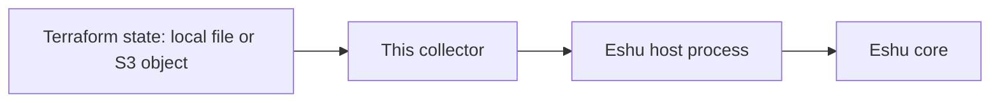
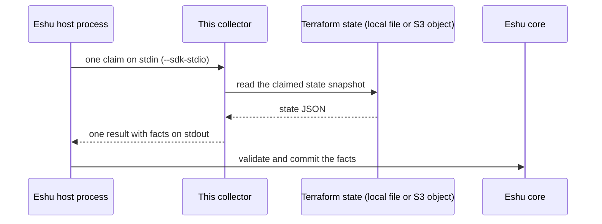
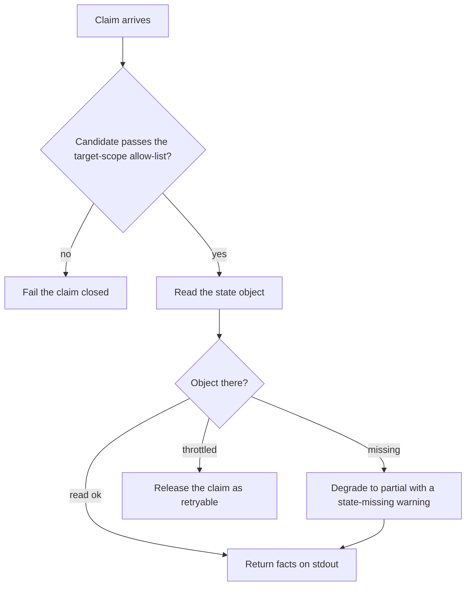

# Diagrams

Every diagram for this collector lives on this page, each with a
caption and a plain-text version so nothing depends on rendering.
Other pages link here instead of copying a diagram. (The repo
[README](../../README.md) keeps the first one as its overview.)

## 1. Where it sits

*Caption: source data flows into this collector, then to the Eshu
host process, then to Eshu core. The collector itself stores
nothing.*

Text version: Terraform state (local file or S3 object) -> this
collector -> Eshu host process -> Eshu core.

## 2. One claim, start to finish

*Caption: one process invocation serves exactly one claim. The host
writes the request, the collector reads the claimed scope, facts
come back on stdout, and the host validates and commits.*

Text version: the host writes one `collector-sdk/v1alpha1` request to
stdin, the collector reads the claimed state snapshot and builds
facts, then writes one result to stdout. The host validates and
commits.

## 3. When something goes wrong

*Caption: the failure paths. Bounded, fail-closed outcomes are
preferred over late, oversized, or silently incomplete evidence;
partial reads say so instead of pretending.*

Text version: a bucket outside the allow-list fails the claim closed.
Missing state objects degrade a live claim to partial with a
`state-missing` warning. Throttling releases the claim as
retryable, and past the retry queue bound of 8 the collector fails
terminal instead of queuing forever.
